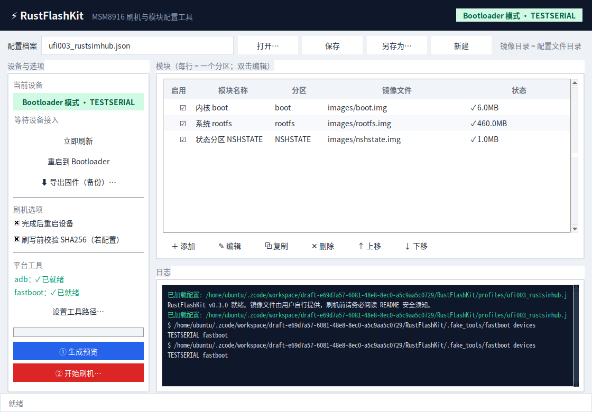
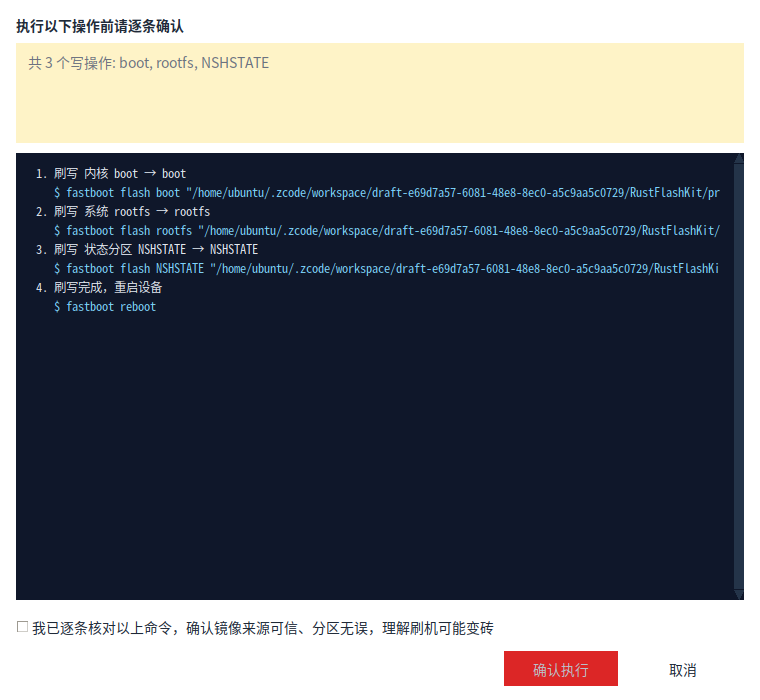
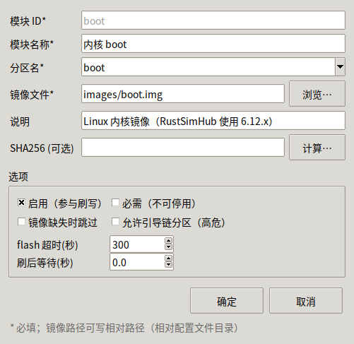
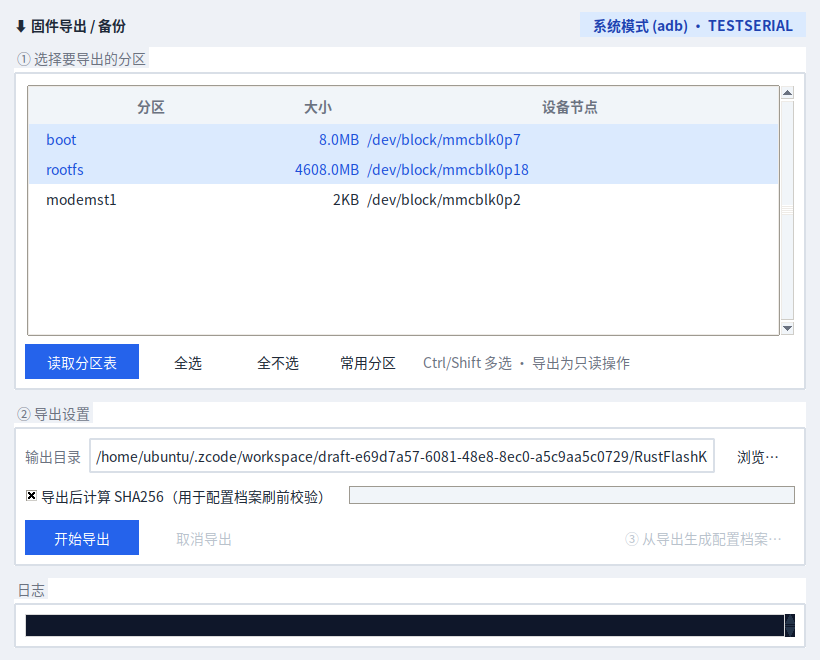

# RustFlashKit

<div align="center">

**MSM8916（骁龙 410 / UFI 棒子）Windows 刷机与模块配置工具**

模块化刷写 · 固件导出备份 · 计划预览与二次确认 · 分区安全策略 · 纯标准库 · 可打包单文件 exe



</div>

---

## 目录

- [简介](#简介)
- [界面导览](#界面导览)
- [功能特性](#功能特性)
- [环境要求](#环境要求)
- [快速开始](#快速开始)
- [如何进入 Bootloader 模式](#如何进入-bootloader-模式)
- [配置档案（Profile）](#配置档案profile)
- [固件导出与备份](#固件导出与备份)
- [安全机制](#安全机制)
- [常见问题](#常见问题-faq)
- [打包为 exe](#打包为-exe)
- [开发与测试](#开发与测试)
- [项目结构](#项目结构)
- [风险与免责声明](#风险与免责声明)

## 简介

RustFlashKit 是一个运行在 **Windows** 上的图形化刷机工具，面向 MSM8916（骁龙 410）平台的 USB 棒子（UFI/dongle），例如 `UFI003_MB_V02`。

它把"刷哪些分区、用什么镜像"抽象成可编辑的**模块配置**：一行 = 一个模块（分区 + 镜像 + 选项），勾选决定是否刷写。执行前生成完整命令序列供逐条核对，配合多级安全策略，尽量把误刷挡在按下回车之前。

本项目参考了 [Viper-Boss/RustSimHub](https://github.com/Viper-Boss/RustSimHub) 的实机信息（**只读参考，两项目相互独立**）：RustSimHub 在 UFI003 上实测使用 `boot` / `rootfs` / `NSHSTATE` 分区，其官方尚未发布通用刷机包——因此本工具是**通用刷写前端，镜像文件由使用者自行提供**（例如你的 RustSimHub 构建产物）。

> 截图在 Linux 测试环境生成，Windows 下的字体与按钮样式会略有差异。

## 界面导览

### 主窗口


- **深色顶栏**：应用标题 + 右侧实时设备状态徽章（绿 = Bootloader 模式、蓝 = 系统模式、红 = 工具缺失）
- **左侧·设备与选项**：设备徽章与详情，自动轮询 adb/fastboot（2 秒一次）；平台工具就绪状态（绿 ✓）；刷机选项；一键「重启到 Bootloader」
- **中间·模块表格**：每行一个模块——勾选框（点击 ☑/☐ 切换，🔒 表示必需项）、模块名、分区、镜像文件、状态（存在显示大小，缺失标红，引导链分区带 ⚠ 标记）
- **左下·动作**：进度条 + `① 生成预览`（蓝）→ `② 开始刷机…`（红），执行期间锁定界面并可取消
- **下方·日志（控制台风）**：实时显示每一条执行的命令与输出，同时写入 `logs/flash-<时间戳>.log`

### 计划预览与确认



执行前必须经过这一步：上方黄色汇总区列出要写哪些分区、跳过了什么、有什么问题；下方深色控制台是**逐条命令序列**。必须勾选风险确认，「确认执行」才可用；若包含引导链分区，还需手动输入「确认引导链」四个字。

### 模块编辑器



双击模块行打开：分区名（下拉提示 MSM8916 常见分区）、镜像路径（浏览，自动转相对路径）、SHA256（一键计算）、超时、刷后延时，以及 启用/必需/缺失跳过/允许引导链 四个开关。

## 功能特性

| 特性 | 说明 |
|---|---|
| 模块化刷写 | Profile JSON 定义模块列表，勾选参与刷写，支持增删改/复制/排序 |
| 计划预览 | 先看完整 `fastboot` 命令序列，dry-run 语义，有问题不允许执行 |
| 强制确认 | 风险勾选确认；引导链分区额外要求输入「确认引导链」 |
| 分区安全策略 | EFS/IMEI 分区一律拒绝；引导链分区需显式允许；分区名合法性校验 |
| SHA256 校验 | 模块可填哈希，刷写前自动比对，不匹配立即中止 |
| 失败即停 | 任何一步失败不再执行后续步骤；执行中可随时取消 |
| 设备管理 | adb/fastboot 双通道探测；系统模式一键重启进 Bootloader |
| 固件导出/备份 | 读取设备分区表，adb 只读导出分区镜像，自动 SHA256，一键生成配置档案 |
| 会话日志 | 窗口实时日志 + 文件存档，事后可追溯 |
| 零依赖 | 仅 Python 标准库（tkinter）；PyInstaller 一键打包 |

## 环境要求

- Windows 10/11 + [Python 3.9+](https://www.python.org/downloads/windows/)（安装时勾选 *Add python.exe to PATH*）
- [Android platform-tools](https://developer.android.com/tools/releases/platform-tools)：`adb.exe`、`fastboot.exe`（含 `AdbWinApi.dll`、`AdbWinUsbApi.dll`）

## 快速开始

```
1. 解压 platform-tools，把 adb.exe / fastboot.exe / Adb*.dll 放入 tools/ 目录
2. 双击 run.bat
3. 文件 → 打开配置… → profiles/ufi003_rustsimhub.json（或新建空白配置）
4. 双击模块行，把「镜像文件」改为你构建出的实际镜像路径
5. 插上设备 → 「重启到 Bootloader」
6. ① 生成预览 → 逐条核对 → ② 开始刷机…
```

## 如何进入 Bootloader 模式

MSM8916 棒子常见方式（按设备状态择一）：

| 设备状态 | 方法 |
|---|---|
| 系统能 adb 连接（工具显示蓝色"系统模式"） | 点左侧「重启到 Bootloader」，或在开始刷机时按提示自动重启 |
| 原 Android 系统还在 | `adb reboot bootloader`；或在关机状态按住设备功能键（如有）插入 USB |
| 完全无法进系统 | 部分设备需拆壳短接进入 9008（EDL）——本工具不支持 EDL 刷写 |

进入成功后设备面板显示绿色 **Bootloader 模式**。

## 配置档案（Profile）

JSON 格式，随文件所在目录作为镜像相对路径的基准。示例：

```json
{
  "schema": 1,
  "name": "UFI003 · RustSimHub 参考模板",
  "board": "UFI003_MB_V02 (MSM8916 / 骁龙410)",
  "modules": [
    {
      "id": "boot",
      "name": "内核 boot",
      "partition": "boot",
      "image": "images/boot.img",
      "enabled": true,
      "required": false,
      "description": "Linux 内核镜像",
      "sha256": "",
      "allow_missing": false,
      "allow_bootloader": false,
      "timeout": 300,
      "post_delay": 0
    }
  ]
}
```

字段说明：

| 字段 | 类型 | 说明 |
|---|---|---|
| `id` | str | 模块唯一标识（小写字母数字、`_`、`-`），创建后不可改 |
| `name` | str | 显示名称 |
| `partition` | str | fastboot 分区名；自动校验合法性（防路径/注入字符） |
| `image` | str | 镜像路径；相对路径基于 Profile 文件所在目录 |
| `enabled` | bool | 是否参与刷写（界面勾选框） |
| `required` | bool | 必需模块：界面不可停用/删除 |
| `allow_missing` | bool | 镜像缺失时跳过并记录，而不是报错中止 |
| `allow_bootloader` | bool | 允许引导链分区（sbl1/aboot/tz/rpm/hyp…）参与刷写 |
| `sha256` | str | 刷前校验哈希；留空不校验 |
| `timeout` | int | 单次 `fastboot flash` 超时秒数（≥10；rootfs 等大镜像建议 ≥600） |
| `post_delay` | float | 该模块刷完后的等待秒数（0–30，个别设备需要喘息） |

内置模板：`profiles/ufi003_rustsimhub.json`（RustSimHub 实测三分区）、`profiles/msm8916_blank.json`（空白）。

## 固件导出与备份



入口：左侧「⬇ 导出固件（备份）…」或 `工具 → 固件导出（备份）…`。导出是**只读**操作，与刷写互斥但本身无风险，是刷机前推荐的自我保护手段。

工作流程：

1. **读取分区表**：设备需处于系统模式（adb 可见）。工具枚举 `/dev/block/bootdevice/by-name/` 下全部分区（名称 + 大小 + 设备节点），自动预选 boot/rootfs/system/recovery/NSHSTATE 等常用分区，可全选或 Ctrl/Shift 自选
2. **开始导出**：逐个分区 `adb pull` 到输出目录（默认 `exports/`），按分区大小自动放大超时；任一失败即停止，已完成的仍然有效
3. **自动 SHA256**（默认勾选）：导出完成即计算镜像哈希
4. **③ 从导出生成配置档案**：一键把本次导出变成可刷写的 Profile（分区名 + 镜像 + SHA256 齐全）并载入主窗口——需要刷回时勾选即可

两点说明：

- **Bootloader (fastboot) 模式没有标准的分区读取命令**，因此导出只在系统模式可用；fastboot 下只能写不能读。
- 与刷写相反，**备份 EFS/IMEI 分区（modemst1/modemst2 等）是强烈推荐的操作**——刷坏前有一份备份，救得回来。若导出报 Permission denied，说明设备的 adbd 无 root 权限，需先刷入 root adbd 的系统再备份。

## 安全机制

刷错分区的代价差异极大，工具内置三道防线：

1. **校验层**：分区名格式、镜像存在性、重复分区、SHA256——问题进 `plan.errors`，有错误不允许执行。
2. **确认层**：完整命令序列预览 + 风险勾选；引导链分区（sbl1、aboot、tz、rpm、hyp 及其 bak 槽位）额外要求输入「确认引导链」。
3. **拒绝层**：EFS/校准分区（`modemst1`、`modemst2`、`fsc`、`fsg`、`ssd`、`persistent`、`devinfo` 等）**无条件拒绝**——刷写会永久丢失 IMEI/网络校准数据，属于不可恢复操作，请永远不要用第三方镜像碰这些分区。

执行期策略：失败即停、可取消、全程留痕。

## 常见问题 FAQ

**Q：左侧显示"未找到 adb / fastboot 工具"**
A：把 platform-tools 的 `adb.exe`、`fastboot.exe`、`Adb*.dll` 放到程序目录的 `tools/` 下，或 `工具 → 设置 adb/fastboot 路径…` 手动指定。

**Q：显示"未授权（请在设备上允许 USB 调试）"**
A：设备弹出授权对话框时点允许；仅影响 adb 模式，Bootloader 模式不需要授权。

**Q：Bootloader 模式下 fastboot 仍看不到设备**
A：多为 Windows 驱动问题。设备管理器里找带感叹号的 "Android"/"QUSB_BULK" 设备，更新驱动为 "Android Bootloader Interface"（可用 platform-tools 自带 `winusb` inf 或第三方驱动工具）。注意：EDL (9008) 模式设备不在本工具支持范围内。

**Q：刷 rootfs 超时失败**
A：在模块编辑器把超时调大（rootfs 建议 ≥600 秒）；同时换 USB 口/线（优先 USB 2.0 接口、劣质线是大数据量刷写失败的头号原因）。

**Q：我的棒子不是 UFI003，能用吗？**
A：可以，但要先确认分区表：新建空白配置，按你的设备实际分区添加模块。更省事的办法是先用「固件导出」里的**读取分区表**功能枚举设备真实分区，再决定要备份/刷写哪些。分区名错误轻则失败、重则变砖，请先在 fastboot 下用 `fastboot getvar all` 核对。

**Q：导出固件时报 Permission denied？**
A：设备的 adbd 没有 root 权限，读不了块设备。这类棒子的原厂/第三方系统通常默认 root adbd；若确实没有，请先刷入带 root adbd 的系统再导出。

**Q：和 RustSimHub 是什么关系？**
A：相互独立的项目。RustSimHub 是设备端固件（Rust 通信系统），RustFlashKit 是通用刷写/配置前端，参考了其实测分区信息；RustSimHub 官方尚未发布通用刷机包，镜像请自行构建并提供。

## 打包为 exe

双击 `build_exe.bat`（需已安装 Python），产物在 `dist/RustFlashKit/`。分发时把 platform-tools 放进其 `tools/` 子目录即可单目录分发。

## 开发与测试

```bash
python -m unittest discover -s tests    # 41 项测试（含假 adb/fastboot 端到端刷机与导出流程）
python -m rustflashkit                  # 启动 GUI
```

测试覆盖：Profile 加载/校验/往返、分区安全策略（EFS 拒绝/引导链门槛/非法名）、计划生成（顺序/跳过/错误收集）、设备探测、执行器（成功流程/SHA256 拦截/失败即停/取消）、导出器（分区表解析/单分区导出/批量流/失败中止/取消）。GUI 无自动化测试，仅冒烟截图脚本（`tests/gui_smoke.py`、`make_screenshots.py`，需 Xvfb）。

## 项目结构

```
RustFlashKit/
├── run.bat / build_exe.bat / rustflashkit.spec   # 启动 / PyInstaller 打包
├── profiles/            # 配置档案（UFI003 参考模板 + 空白模板）
├── tools/               # 放 adb.exe / fastboot.exe（自取 platform-tools）
├── docs/screenshots/    # README 截图
├── rustflashkit/
│   ├── core/
│   │   ├── runner.py    # 工具定位 + 子进程执行（参数列表，不经 shell）
│   │   ├── device.py    # adb/fastboot 设备探测与模式切换
│   │   ├── modules.py   # 模块/Profile 模型、校验、SHA256
│   │   ├── plan.py      # 刷机计划生成（dry-run 语义）
│   │   ├── safety.py    # 分区风险分级与强制校验
│   │   ├── flasher.py   # 后台线程执行器（失败即停/可取消）
│   │   ├── exporter.py  # 固件导出：分区表读取 + adb pull 批量备份
│   │   └── config.py    # 设置与会话日志
│   └── gui/
│       ├── app.py       # 主窗口
│       ├── dialogs.py   # 模块编辑器 / 计划预览 / 设置
│       ├── export_dialog.py  # 固件导出（备份）对话框
│       └── theme.py     # 调色板与主题
└── tests/               # 单元测试 + 假工具 + GUI 冒烟
```

## 风险与免责声明

- **刷机有变砖风险**。引导链分区刷错需 9008 工具救砖；EFS 分区刷错丢 IMEI 且**不可恢复**（工具已强制拒绝，但请知悉边界）。
- 不同棒子分区表可能不同，分区名以你设备 `fastboot getvar all` 实测为准。
- 拿不准时先只刷 `boot` 验证镜像与链路，再刷 `rootfs`。
- 镜像来源自行把关：建议填写 `sha256` 字段做刷前校验。
- 本工具仅供个人设备维护与学习研究使用，使用者对操作后果自行负责。
